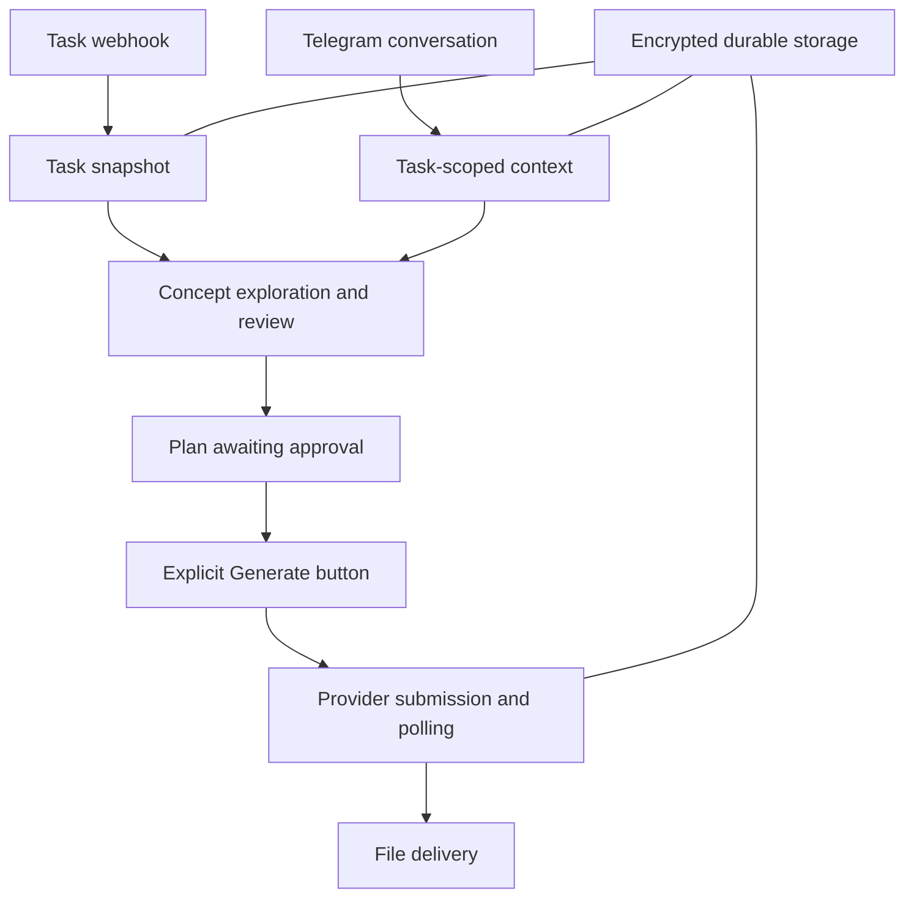

# Creative Workflow Bot

A Node.js service that turns task-system briefs into a reviewed creative workflow inside Telegram. It keeps conversations and reference assets scoped to a task, develops and reviews concepts, and requires a separate approval before submitting image-generation jobs.

This portfolio edition contains fictional tasks, sample copy and synthetic campaign records. No client assets, production credentials or historical campaign examples are bundled.

## Try the offline demo

Requires Node.js 22 or later and npm. No service accounts, API keys or Redis instance are needed for the demo.

```sh
npm ci
npm run demo
```

Open **http://127.0.0.1:3001**.

1. Receive the fictional task notification.
2. Choose a task status or prepare a design plan.
3. Review the proposed concepts. Running pending work stops at the approval checkpoint.
4. Click the bot's **Generate** button to simulate submission, polling and file delivery.
5. Try task chat, reference classification, cancellation and completion.

The demo runs the actual orchestration functions with in-memory storage and deterministic service adapters. It does not forward network requests to external services. Its model replies and preview artwork are **simulated**, not real AI generations. State resets on restart; use **Reset demo** to begin again. Set `DEMO_PORT` to change the local port.

## Workflow



## Engineering features

- **Separated approvals:** preparing a brief or discussing a task does not start image generation. Old buttons cannot authorize a different plan.
- **Reference roles:** visual inspiration, an explicit offer update and an exact brand asset are separate inputs. Visual-only text cannot replace task facts.
- **Durable jobs:** state is saved before a paid submission. An interrupted submission is not blindly repeated; polling and delivery resume separately.
- **Task isolation:** conversation history, references, offer overrides and saved preferences have explicit scopes.
- **Independent statuses:** status changes do not complete tasks. Completion requires delivered files and a separate action.
- **Cancellation and revision:** invalidate ungenerated plans and clear queued turns without mutating an already submitted request.
- **Configurable content:** sample profiles live in `creative-profile.json`; matching and memory scopes come from configuration. Workspace status labels are environment settings.
- **Localization capability:** target market and language are task inputs. Public examples use English and synthetic locale labels, without reproducing campaign translations.
- **Optional exact asset placement:** an uploaded logo can be composited after generation. No real logo assets are included.

## Project structure

| File | Responsibility |
| --- | --- |
| `server.js` | HTTP endpoints, OAuth, Telegram actions, reference ingestion, storage and job workers |
| `creative-director.js` | Concept schemas, validation and selection policy |
| `task-chat.js` | Conversation schema and allowed task-chat actions |
| `creative-profile.json` | New fictional profiles and campaign records |
| `demo/runtime.cjs` | Offline adapters around the real workflow functions |
| `demo/server.cjs` | Local demo HTTP server |
| `demo/index.html` | Interactive simulated Telegram workspace |
| `test.cjs` | Core regression tests with mocked services |
| `demo/test.cjs` | Offline demo and HTTP tests |
| `scripts/check-public-content.cjs` | Generic credential/contact-data check |

## Run the checks

```sh
npm test
npm run check:public
```

Tests mock external services. They cover approval gating, interrupted submissions, duplicate events, task/reference isolation, cancellation, status changes, completion, conversation actions and the offline demo. Passing tests do not claim a live provider integration was exercised.

## Optional live integration

The integration architecture remains available in `server.js`:

- **Worksection:** task webhooks and OAuth-based task/status operations.
- **Telegram Bot API:** conversation, inline approvals and document delivery.
- **Upstash Redis REST:** durable queues, locks and encrypted state.
- **OpenAI Responses API:** structured concept planning and task chat.
- **Gemini:** optional reference analysis and concept critique.
- **Magnific MCP:** explicit Grok Imagine 2.0 requests and status polling.
- **Sharp:** optional exact-asset compositing.

Use `.env.example` as a blank configuration template. Configure your own accounts, OAuth apps, HTTPS callbacks and an independent strong `SESSION_SECRET`. Use separate storage for a public demonstration.

After configuring `.env`, start a local live service with:

```sh
node --env-file=.env server.js
```

For a managed host, configure the environment in the host's settings and use `npm start`. Live configuration, model access and current provider capabilities must be verified with your own accounts. The offline demo always uses its synthetic adapters, regardless of live environment settings.

### Common Telegram actions

`/help`, `/talk TASK_ID`, `/task TASK_ID`, `/job TASK_ID`, `/regenerate TASK_ID`, `/cancel TASK_ID`, `/adapt`, `/clear_refs TASK_ID`, `/logo TASK_ID`, `/mark_logo TASK_ID`, `/memory`, `/remember SCOPE RULE`.

Status labels default to `Queued` and `In progress`; set `WORKSECTION_QUEUE_LABEL` and `WORKSECTION_WORK_LABEL` to match your workspace. Memory scopes are `global` plus configured profile keys.

## Portfolio summary

Built a task-driven creative workflow connecting task intake, conversational review and approval-gated generation. The backend uses structured model responses, encrypted durable state, scoped references and recoverable background jobs. This repository demonstrates it using fictional content and offline adapters.

No Git history or deployment data is included. Start a new repository from this edition without importing an existing project's history. No license grant is added by this package; select a license only if you have the rights to grant it.
